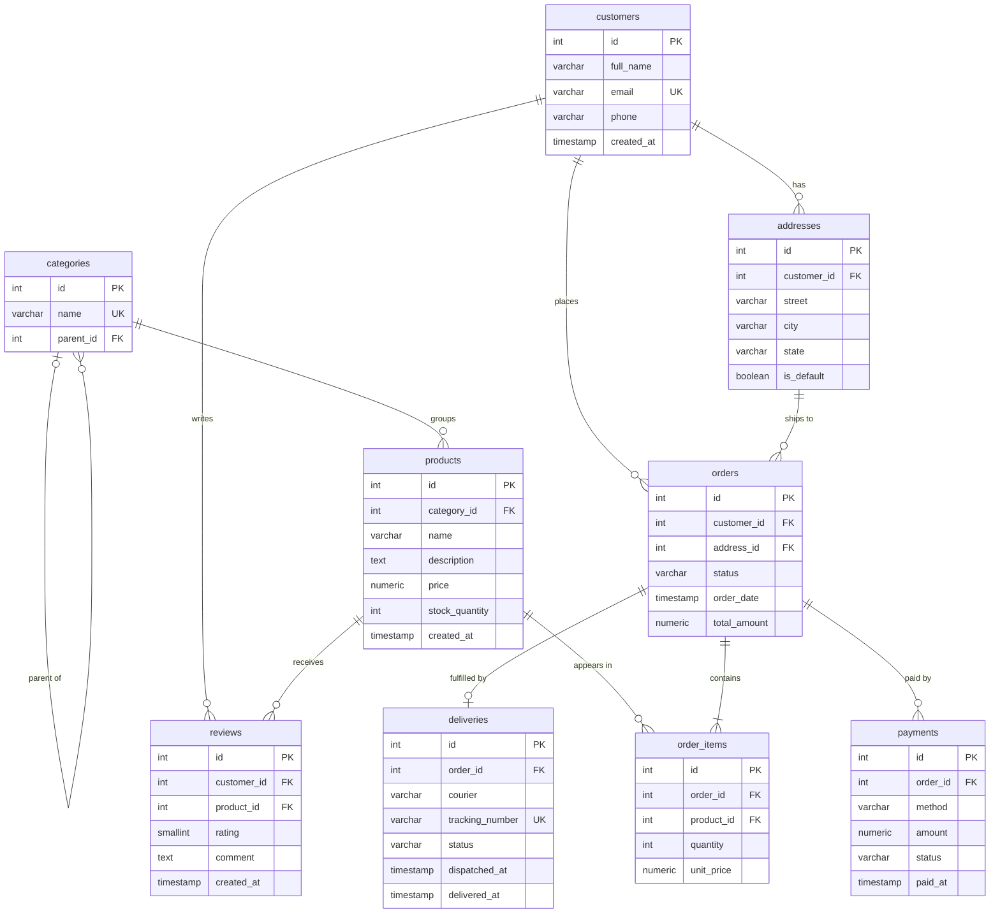

# Portfolio 1: Database Design and Modelling

**Course:** MIT 8103 Advanced Database Systems
**Student:** Adejoke Ogunyinka (30150302)
**DBMS:** PostgreSQL 17

---

## 1. Selected Case Study: Cartify

**Organisation:** Cartify is a simulated Nigerian online retail platform. Customers browse a catalogue of consumer goods (electronics, fashion, groceries, home items), place orders, pay through local channels (card, bank transfer, USSD, wallet, cash on delivery), and have goods delivered by third-party couriers to addresses across Nigeria. Prices are in naira.

**Nature of the system:** A transactional, online e-commerce system. It is write-heavy at checkout (orders, stock changes, payments) and read-heavy on the storefront (catalogue search, product pages, order history).

**Users of the database:**
- *Customers*, through the web and mobile storefront (browse, order, pay, track, review).
- *Operations staff*, through an admin panel (add products, update stock, update delivery status).
- *Finance staff* (reconcile payments, process refunds).
- *Management*, through reports (sales by category, top products, revenue by state).

**Major data stored:** customers and their delivery addresses, product categories, products with price and live stock, orders and their line items, payments, deliveries, and product reviews.

**Key operations the database supports:**
1. Add or update a product and its stock.
2. Place an order: create the order, add its items, and reduce stock atomically.
3. Record a payment against an order.
4. Dispatch and track a delivery.
5. Search the catalogue by name or category.
6. Retrieve a customer's order history.
7. Report top-selling products and revenue by category or state.

Operations 2 and 3 become the transaction examples in Portfolio 3. Operations 5, 6 and 7 become the optimisation queries in Portfolio 2.

---

## 2. Entity-Relationship Diagram

The diagram below is rendered by GitHub from Mermaid source. A dbdiagram.io version is in `diagrams/cartify-er-diagram.png`, generated from `diagrams/cartify.dbml`.



### Relationship summary

| Relationship | Cardinality | Why |
|---|---|---|
| customers to addresses | 1 to many | A shopper can ship to home, office, or a relative. |
| customers to orders | 1 to many | A shopper places many orders over time. |
| addresses to orders | 1 to many | Each order ships to exactly one address; an address is reused. |
| categories to categories | 1 to many (self) | Sub-categories such as Phones under Electronics. |
| categories to products | 1 to many | Each product belongs to one category. |
| orders to order_items | 1 to many | An order has one or more lines. |
| products to order_items | 1 to many | A product appears in many orders. Together with the row above this resolves the many-to-many between orders and products. |
| orders to payments | 1 to many | A failed attempt can be followed by a successful one. |
| orders to deliveries | 1 to 1 (optional) | An order has at most one delivery record. |
| customers to reviews, products to reviews | 1 to many | A customer reviews a product once. |

### Many-to-many relationships

A relational database cannot store a many-to-many relationship directly, because a foreign key column holds one value, not a list. Each many-to-many is therefore *resolved* into two one-to-many relationships through a junction (associative) table:

| Many-to-many | Junction table | Extra attributes carried | Uniqueness rule |
|---|---|---|---|
| orders to products | `order_items` | quantity, unit_price | one row per (order_id, product_id) |
| customers to products | `reviews` | rating, comment, created_at | one row per (customer_id, product_id) |

The unique constraint on the pair of foreign keys is what makes the junction table a correct representation: the same pairing cannot be recorded twice.

---

## 3. Relational Schema

Written as `TABLE(attributes)`, primary keys underlined by convention, foreign keys marked FK.

```
customers   (id, full_name, email, phone, created_at)
addresses   (id, customer_id FK, street, city, state, is_default)
categories  (id, name, parent_id FK)
products    (id, category_id FK, name, description, price, stock_quantity, created_at)
orders      (id, customer_id FK, address_id FK, status, order_date, total_amount)
order_items (id, order_id FK, product_id FK, quantity, unit_price)
payments    (id, order_id FK, method, amount, status, paid_at)
deliveries  (id, order_id FK, courier, tracking_number, status, dispatched_at, delivered_at)
reviews     (id, customer_id FK, product_id FK, rating, comment, created_at)
```

The full DDL is in `sql/01_schema.sql`.

---

## 4. Keys and Constraints

**Primary keys.** Every table uses a `SERIAL` integer surrogate key named `id`. A surrogate key is stable (an email can change, an id cannot), compact for indexing, and simple to reference.

**Foreign keys.** Every relationship in the diagram is enforced with `REFERENCES`. PostgreSQL rejects an order for a customer that does not exist. `ON DELETE CASCADE` is used only where the child has no meaning without the parent (addresses, order_items, payments, deliveries, reviews). It is deliberately *not* used from orders to customers, so a customer with order history cannot be silently deleted.

**Unique constraints.**
- `customers.email`: one account per email.
- `categories.name`: no duplicate category names.
- `order_items (order_id, product_id)`: a product appears once per order; quantity is changed instead of adding a second line.
- `deliveries.order_id`: enforces the 1 to 1 relationship.
- `deliveries.tracking_number`: couriers issue unique tracking numbers.
- `reviews (customer_id, product_id)`: one review per customer per product.

**Check constraints.**
- `price >= 0`, `unit_price >= 0`, `amount >= 0`, `total_amount >= 0`: money is never negative.
- `stock_quantity >= 0`: the database itself refuses to oversell. This constraint is central to the concurrency demonstration in Portfolio 3.
- `quantity > 0`: an order line of zero items is meaningless.
- `rating BETWEEN 1 AND 5`.
- Status columns are restricted to named values with `CHECK (status IN (...))`, acting as lightweight enumerations.

**NOT NULL and defaults.** Columns that must always have a value are `NOT NULL`. Timestamps default to `NOW()`, statuses default to their starting state (`pending`, `processing`).

**Data types.** Money uses `NUMERIC(12,2)`, never `FLOAT`, because floating point cannot represent 0.10 exactly and rounding errors accumulate in financial totals.

---

## 5. Normalisation

### First Normal Form (1NF): atomic values, no repeating groups
Every column holds a single value. The clearest case is addresses. A naive design would put `address_line_1`, `address_line_2`, `address_line_3` on `customers`. That caps the number of addresses, leaves most cells empty, and makes "find all customers in Lagos" awkward. Instead `addresses` is its own table with one row per address, linked by `customer_id`. Similarly an order's products are not stored as a comma-separated list on `orders`; each product is a row in `order_items`.

### Second Normal Form (2NF): no partial dependency on a composite key
2NF only matters where a key is composite. The natural key of `order_items` is `(order_id, product_id)`. `quantity` and `unit_price` depend on that whole pair: the quantity of *this product* in *this order*. Nothing in `order_items` depends on `product_id` alone (product name, for example, is not stored there) or on `order_id` alone (order date is not stored there). So `order_items` is in 2NF. The same reasoning applies to `reviews` with `(customer_id, product_id)`.

### Third Normal Form (3NF): no transitive dependency
A non-key column must depend on the key, and nothing but the key. Examples of what was avoided:
- `products` stores `category_id`, not `category_name`. Category name depends on category id, not on product id. Storing it on products would be a transitive dependency and would require updating every product when a category is renamed.
- `orders` stores `address_id`, not the street and city. The address depends on the address id.
- `order_items` does not store the product name or current stock, only the product id.

### Deliberate denormalisation (and why it is still correct)
Two columns look like duplication but are not:
- **`order_items.unit_price`** copies the product price at the time of purchase. This is not a transitive dependency because it is a *different fact*: the price the customer actually paid, which must survive future catalogue price changes. Historical accuracy requires it.
- **`orders.total_amount`** is derivable from `order_items`. It is stored for reporting speed and set inside the same transaction that inserts the items (see Portfolio 3), so it cannot drift.

The schema is therefore in 3NF, with two documented, justified exceptions that preserve historical facts and reporting performance.

---

## 6. How this was implemented and tested

1. PostgreSQL 17 installed via Homebrew and started as a service.
2. Database created: `createdb cartify`.
3. Schema loaded: `psql -d cartify -f sql/01_schema.sql`.
4. Verified with `\dt` (nine tables) and `\d orders` (constraints visible).
5. Constraint tests in `sql/02_constraint_tests.sql` confirm the database rejects negative stock, invalid status, duplicate email, and orphan foreign keys.
6. Seed data generated with sql/03_seed_data.sql: 5,000 customers, 500 products, 50,000 orders and about 150,000 order lines. Verified with row counts.

Screenshots of these steps are in `screenshots/`.

---

## 7. Design choices and challenges (reflection notes)

- Chose surrogate integer keys over natural keys (email, tracking number) because natural keys change and are long to index.
- Chose a self-referencing `categories` table over a fixed two-level design so the hierarchy can grow.
- Kept `payments` separate from `orders` after realising a single `payment_status` column on orders could not represent a retry after a failed attempt.
- The hardest decision was whether storing `unit_price` on `order_items` violates 3NF. It does not, because it records a historical fact rather than duplicating a current one.
- To prepopulate the order table, I wrote a script with the help of AI that used random() to choose customers and delivery/house address. There was a bug where the sub-query for the random ran only once and assigned all the orders to a single customer (the same customer). The fix was to make the query run every time we needed to populate each order row. NB: PostgreSQL may run a sub-query only once if nothing inside it depends on the current row. That's usually a good thing for speed. It's a trap when the sub-query is supposed to produce something different each time.
